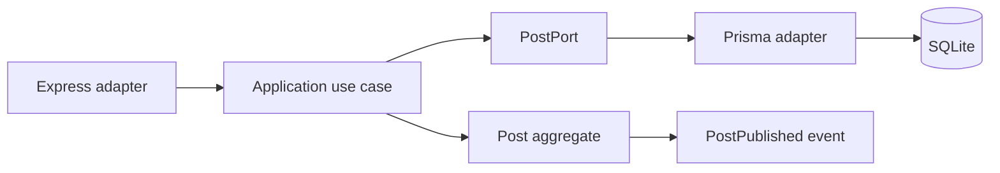

# Tactical DDD and Clean Architecture

Domain-driven design is useful when the business language contains rules that
must stay coherent across interfaces and persistence. In `ddd-01/blog`, a
`Post` aggregate owns publication state, `Slug` is an immutable value object,
and domain errors are independent of Express and Prisma.

The Clean Architecture dependency rule points inward: domain code imports no
framework or database package; application code coordinates a workflow; outer
adapters translate transport and persistence. This is a dependency direction,
not a requirement to create one class per noun. A small URL shortener may need
only a value object and a few validation functions, while the blog's publishing
workflow justifies an aggregate and event vocabulary.

An aggregate is a consistency boundary. The caller changes it through methods
that preserve invariants, then persists the resulting state in one transaction.
The `PostPublished` event is in-process and drained once. It is not durable
delivery; an outbox would be required if a notification must survive a process
crash. The example deliberately excludes event sourcing, CQRS, and a broker.

## Exercises

1. Add a rule that scheduled posts require a future timestamp and test it in the
   aggregate without Prisma.
2. Search the domain directory for imports of `express`, `prisma`, and
   `better-sqlite3`; explain why the architectural test rejects them.
3. Identify one rule that belongs in the application layer rather than the
   aggregate and justify the boundary.
