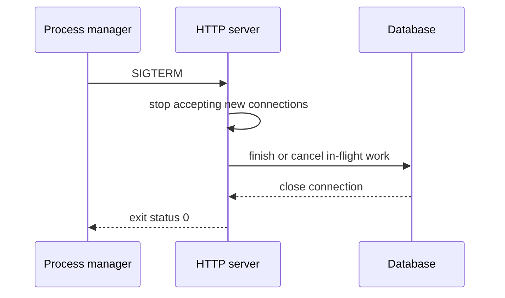

# Production engineering boundaries

The labs run as local single-process applications. A production service adds
constraints that are often hidden behind a framework: configuration must be
validated at startup, logs need correlation and redaction, health checks must
reflect dependencies, migrations need ownership, and shutdown must stop new
work before closing the database.

Node's `process` receives signals; it does not automatically make an Express
server graceful. The variant servers register shutdown handlers explicitly.
The correct timeout, retry policy, and concurrency limit depend on deployment
measurements, so this book does not invent benchmark numbers.

Operational extensions outside the labs include multi-process rate-limit state,
managed secrets, TLS termination, backups, restore drills, structured logs,
metrics, tracing, and dependency vulnerability policy. They are future work,
not capabilities implied by a passing unit test.

## Exercise

Start one variant, send SIGTERM, and inspect whether its database connection is
closed. Then add a bounded shutdown timeout and test the behavior with a fake
server; document the tradeoff between graceful completion and fast replacement.
